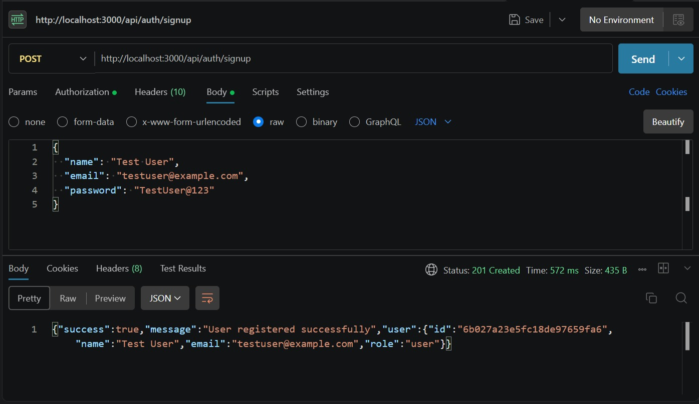

# Secure Connect – Secure Backend & Real-Time Communication Platform

Secure Connect is a backend-based communication platform built using Node.js, Express.js, MongoDB and Socket.IO. It provides secure user authentication, role-based access control, personal notes management and real-time private messaging.

## Features

- User Registration and Login
- Password Hashing using bcrypt
- JWT-based Authentication
- Protected API Routes
- Role-Based Access Control (RBAC)
- Notes CRUD Operations
- Real-Time Private Messaging using Socket.IO
- Chat Users and Conversation APIs
- MongoDB Database Integration
- Custom Events using Node.js EventEmitter
- Environment Configuration using dotenv

## Tech Stack

**Backend:** Node.js, Express.js

**Database:** MongoDB, Mongoose

**Authentication:** JWT, bcrypt

**Real-Time Communication:** Socket.IO

**Other Tools:** dotenv, CORS, Nodemon, Postman

## Project Structure

```text
Secure_Connect/
│
├── config/
│   └── db.js
├── controllers/
│   ├── authController.js
│   ├── messageController.js
│   └── noteController.js
├── events/
│   ├── eventHandler.js
│   └── messageEvents.js
├── middleware/
│   └── authMiddleware.js
├── models/
│   ├── Message.js
│   ├── Note.js
│   └── User.js
├── public/
│   ├── app.js
│   ├── index.html
│   └── style.css
├── routes/
│   ├── authRoutes.js
│   ├── messageRoutes.js
│   ├── noteRoutes.js
│   └── protectedRoutes.js
├── .env
├── .gitignore
├── package.json
├── package-lock.json
└── server.js
```

## Installation and Setup

1. Clone the repository:

```bash
git clone https://github.com/sumanmishra07/Secure_Connect
```

2. Open the project folder:

```bash
cd Secure_Connect
```

3. Install dependencies:

```bash
npm install
```

4. Create a `.env` file in the root directory:

```env
PORT=3000
MONGO_URI=mongodb://127.0.0.1:27017/secure_connect
JWT_SECRET=your_long_random_secret
NODE_ENV=development
```

5. Start the development server:

```bash
npm run dev
```

## API Endpoints

| Method | Endpoint | Description |
|---|---|---|
| POST | /api/auth/signup | Register user |
| POST | /api/auth/login | Login user |
| GET | /api/protected/profile | Get user profile |
| GET | /api/protected/admin | Admin-only route |
| GET | /api/protected/user | User-only route |
| POST | /api/notes | Create note |
| GET | /api/notes | Get all personal notes |
| GET | /api/notes/:id | Get a specific note |
| PUT | /api/notes/:id | Update note |
| DELETE | /api/notes/:id | Delete note |
| GET | /api/messages/users | Get chat users |
| GET | /api/messages/:userId | Get conversation |

## Real-Time Messaging

Secure Connect uses Socket.IO for authenticated real-time private messaging. Users connect using JWT authentication and can send messages to other registered users.

## Security

- Passwords are hashed using bcrypt.
- JWT authentication protects private routes.
- Role-based middleware restricts access.
- Users can access only their own notes.
- Sensitive environment variables are excluded from Git.

## Author

Developed as a Web Development III lab project.
## Screenshots




